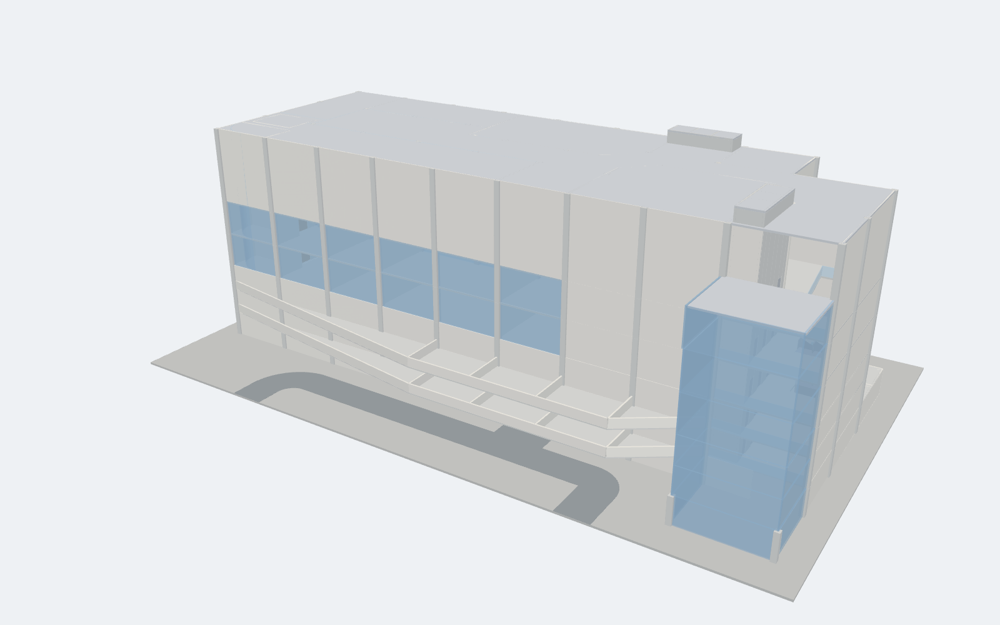

# Entertainment Complex, Dewata, Galle: 3D model

This 3D model was built from `Concept_Desg2 (1).dwg`. It follows the tasks in
`CAD explanation for 3d model.docx`.

## Why there is no `.rvt` or `.dwf` file in this folder

RVT and DWF are closed Autodesk formats. Only Revit, AutoCAD or Autodesk
cloud services can write them, and those were not available where this model
was built (Linux, no Autodesk software). The model is complete in the files
below, and Revit turns it into `.rvt` + `.dwf` in a couple of minutes. Pick
**one** of these routes:

### Route A: open the IFC in Revit (quickest, about 1 minute)
1. Revit 2027: **File > Open > IFC**, then select `Entertainment_Complex.ifc`.
2. **File > Save As > Project**, saved as `Entertainment_Complex.rvt`.
3. **File > Export > DWF/DWFx**. Pick the 3D view and the level plans, then
   export `Entertainment_Complex.dwf`.

All 6 storeys come in as Revit levels. Walls, floors, columns, stairs, ramps,
railings, doors, furniture and so on come in under their own Revit categories,
with materials and colours. These elements are imported geometry, not
editable system families.

### Route B: build native, editable Revit elements (about 5 minutes)
`build_revit_model.py` reads `model.json` and creates native Revit elements:
levels and plans, grids, walls with wall types, curtain walls, floors with
openings, structural columns, stairs, railings and rooms. Things that have no
reliable API (the helical ramp, escalators, cinema seats, screens, stadium
risers, lift cars, parking stalls) are created as DirectShapes in the correct
category. When it finishes, the script saves **`Entertainment_Complex.rvt`**
and exports **`Entertainment_Complex.dwf`** and **`.dwfx`** next to
`model.json`.

1. Revit: **File > New > Project** (Architectural / Metric template).
2. **Manage > Dynamo**, then New.
3. Add a **File Path** node and point it at `model.json`. Connect it to
   `IN[0]` of a **Python Script** node (CPython3).
4. Paste the whole contents of `build_revit_model.py` into the node, then **Run**.

   (With pyRevit or RevitPythonShell you can run the file directly instead.
   Keep `model.json` in the same folder.)
5. A log is written to `build_revit_model.log`. If any element type fails, the
   script falls back to a DirectShape. Revit warnings are suppressed.

The group's existing `group1revit.rvt` is not modified. Build in a new project,
then copy or link it into the group file if needed.

### Route C: AutoCAD or DWG TrueView (DWF only)
Open `Entertainment_Complex_3D.dxf`. It contains 3D meshes on AIA layers, in
metres. Use the `3DDWF` command in AutoCAD, or Publish > DWF in TrueView.

## Files

| File | What it is |
|---|---|
| `Entertainment_Complex.ifc` | IFC4 BIM model: 1,449 elements, 7 storeys, materials, property sets, grid. Schema-valid, and every element's geometry was checked. |
| `build_revit_model.py` | Revit 2023+ script that builds the native model, saves RVT and exports DWF/DWFx |
| `model.json` | All geometry extracted from the DWG, in metres (the input for the Revit script) |
| `Entertainment_Complex_3D.dxf` | 3D model for AutoCAD / TrueView / Revit "Link CAD" |
| `Entertainment_Complex.glb` | 3D model for any glTF viewer (Windows 3D Viewer, Blender, web) |
| `previews/` | Renders, plus `plan_check_all_levels.png` (every level overlaid on the extracted plan data) |
| `tools/` | The extraction and generation pipeline, so the model can be rebuilt (`run_pipeline.sh`) |

## Coordinates and levels

The origin (0,0) is grid **1/B**. That is the south-west column of the
ground-level parking plan (DWG point 56.30, 28.12). +X runs east along the
74 m frontage and +Y runs north, away from the A2 road. All four plans were
aligned on their common 8 m column grid.

| Level | Name | Elevation | Storey height | Plan used |
|---|---|---|---|---|
| L00 | Ground Level Parking | ±0.00 | 3.2 m | GROUND LEVEL PARKING PLAN (63 cars noted) |
| L01 | First Level Parking | +3.20 | 3.2 m | FIRST & SECOND LEVEL PARKING PLAN (54 cars) |
| L02 | Second Level Parking | +6.40 | 3.2 m | FIRST & SECOND LEVEL PARKING PLAN (54 cars) |
| L03 | First Floor | +9.60 | 4.2 m | FIRST & SECOND FLOOR PLAN (restaurants, cafés, gaming) |
| L04 | Second Floor | +13.80 | 4.2 m | FIRST & SECOND FLOOR PLAN |
| L05 | Third Floor (Cinema) | +18.00 | 9.0 m | THIRD FLOOR PLAN (3 theatres) |
| L06 | Roof | +27.00 | | Matches the 27.0 m height in the DWG front elevation |

## What was modelled, task by task (from the explanation document)

**1. Ground-level parking**
- **Parking bays:** 66 stalls, taken exactly from the 22 "3car bay" blocks.
  The drawing note says 63; the geometry was kept as drawn.
- **Vehicle circulation:** the green loop aisle, the two-way entrance spine
  and both curved driveways to the A2 road.
- **Ramp:** the start of the spiral ramp.
- **Lifts:** 2 banks of 3 lifts (crossed rectangles; these are not columns).
- **Service areas:** the STP, CHILLER and Main Switch rooms, with partitions
  and room names.
- **Staircase:** included.

**2. First and second parking levels**
- **Parking bays:** 54 stalls on each level.
- **Circulation loop:** the elongated loop with curved ends, with the J-ramp
  forming its east turn.
- **Ramp:** 6.0 m wide, two lanes, inner radius 3.0 m, outer radius 9.0 m.
  Centre-line 25.97 m, the length labelled in the DWG.
  - It rises one storey (3.2 m), a slope of **12.3 % (1:8.1)**. That is within
    the usual 1:8 car-park limit.
  - It starts at the "UP" end (lower end, x 57.5–63.4 / y 14.0) and ends at
    the "DOWN" end (x 47.7 / y 26.75–32.75).
  - The ramp is stacked GF→P1 and P1→P2, so cars drive a continuous spiral
    through the parking levels.
  - It has 1.0 m kerb walls on both edges. The P1 and P2 slabs are opened over
    the ramp, with 1.1 m upstands around each opening.

**3. First and second floors**
- **Structure and walls:** columns, perimeter and shop walls, and glazed
  shopfronts.
- **Façade:** glazed front façade (the hatched band in the front elevation)
  and the curved glazed corner wall.
- **Vertical circulation:** the staircase, both lift banks, the central
  escalator void and the east escalator void, with glass balustrades.

**4. Third floor, the cinema** (seat counts match the DWG exactly)

| Theatre | Seats | Layout | Screen |
|---|---|---|---|
| T1 (upper-left) | 108 | 12 rows × 9 | 6.0 m curved screen on its west wall |
| T2 (upper-middle) | 200 | 13 rows | 8.5 m curved screen on its west wall |
| T3 (lower-right) | 136 | 7 rows | 8.5 m curved screen on its south wall |

- The screen positions and orientations come from the screen arcs in the DWG.
- **Stadium seating:** each row steps up 350 mm, so the back rows sit at
  +3.85 m (T1) and +4.20 m (T2). That leaves more than 4.5 m of headroom
  under the 9 m storey.
- Circulation and foyer areas are left clear.

**Vertical circulation (all floors)**
- **Staircase:** dog-leg stair in the 6.25 × 5.0 m enclosure, with 1.8 m
  double doors on every floor.
  - 3.2 m storeys: 18 risers of 178 mm.
  - 4.2 m storeys: 24 risers of 175 mm.
  - Going: 280 mm, matching the tread counts drawn in the DWG.
- **Escalator pairs:** at 30°.
  - East pair: 8 m units from ground to first floor, then 9.7 m units up to
    the third floor.
  - Central pair: 9.6 m units from first floor to third floor.
- **Lift shafts:** continuous from ground to +28.5 m (1.5 m overrun), with a
  1.1 m landing door to every floor.

## Assumptions (where the DWG gives no value)

**Thicknesses**
- RC slabs: 200 mm. Ground slab: 250 mm, extended over the 80 × 50 m (1 acre)
  plot as external paving.
- Walls are drawn as double lines 100 mm apart. They are modelled on that
  centre-line as 200 mm blockwork.
- Service partitions: 150 mm. Glazing: 100 mm. Lift shafts: 200 mm RC.
- Columns: 600 × 600 mm on every column square in the DWG.

**Outlines and roofs**
- The upper floors are 26 m deep and the parking decks 34 m (both as drawn).
  The exposed rear strip of the second parking deck gets a podium roof slab
  at first-floor level, with a parapet.
- The single-storey STP/chiller annex has its own roof.
- The glazed atrium box at the east end of the frontage is open inside and
  has its own roof at **+22.0 m**, as in the front elevation.

**Interpretations**
- The trapezoid drawn in front of the first/second parking plan is modelled
  as a 5.5 m projecting planter slab with 1.1 m parapets, on both parking
  decks.
- The stair on the first/second parking plan is drawn 0.25 m east of the same
  stair on the other plans. It was aligned with them so that it stacks
  vertically.
- A stray single line at x = 24 m inside theatre 1 (left over from the
  first-floor plan) was ignored, because it would cut through the seat rows.

## Checks that were run

- **IFC schema:** 0 errors. All 1,449 elements built 3D geometry
  (IfcOpenShell).
- **Plan overlay:** every level of the extracted model was plotted over the
  DWG geometry (`previews/plan_check_all_levels.png`).
- **Counts:** seat counts (108 / 200 / 136), parking counts (66 / 54 / 54) and
  the ramp centre-line (25.97 m) were checked against the drawing.
- **Revit script:** dry-run against a stubbed Revit API, covering both the
  native paths and the fallback paths. It still needs a first real run inside
  Revit.
